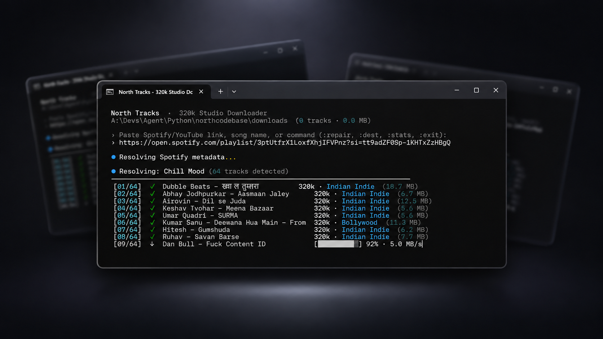

<p align="center">
  
</p>

<h1 align="center">North Tracks</h1>

<p align="center">
  <b>Download any song or playlist in 320kbps studio audio. Clean, fast, and organized.</b>
</p>

<p align="center">
  
  
  
  
</p>

---

## ⚡ What is North Tracks?

North Tracks is a minimal music downloader for your terminal. Paste any Spotify playlist, YouTube link, or song title, and it downloads authentic 320kbps audio, tags official HD album covers, embeds lyrics, and neatly organizes everything into folders for you.

---

## 📋 What You Need Before Installing

* **Python 3.9 or higher** installed on your computer.  
  *(If you don't have Python, download it with 1 click from [python.org](https://www.python.org/downloads/) — make sure to check **"Add Python to PATH"** during install).*
* An active internet connection.

---

## 🚀 How to Install

### Option A: Windows (Easiest — 1-Line Command)
Open **PowerShell** (search for "PowerShell" in Start menu), paste this single line, and press **Enter**:

```powershell
irm https://raw.githubusercontent.com/nishantkumrmishra/north-tracks/main/install.ps1 | iex
```
*That's it! It automatically sets up everything and creates the `northtracks` command on your PC.*

---

### Option B: Any System (Windows, Mac, Linux via pip)
Open your terminal and run:

```bash
pip install git+https://github.com/nishantkumrmishra/north-tracks.git
```

---

## 🎧 How to Use

### 1. Launch North Tracks
In any terminal or Command Prompt, simply type:
```bash
northtracks
```

### 2. Paste what you want to download
You can paste:
* **Spotify link** (Playlist, Album, or single song)
* **YouTube link** (Any music video or audio stream)
* **Song name** (e.g. `Kesariya`, `Heat Waves`, `Alag Aasmaan`)

```text
  North Tracks  •  320k Studio Downloader
  A:\Devs\Agent\Python\northcodebase\downloads  (81 tracks • 683.4 MB)

  › Paste Spotify/YouTube link, song name, or command (:repair, :dest, :stats, :exit):
  › https://open.spotify.com/playlist/3ptUtfrX1LoxfXhjIFVPnz
```

North Tracks will automatically:
1. Stream in **320kbps AAC studio audio**.
2. Download official **HD artwork** from Apple Music and JioSaavn.
3. Automatically route the song into its category folder (`Indian Indie/`, `Bollywood/`, `Pop/`, `Punjabi/`, etc.).
4. **Skip duplicates** so you never download the same song twice.
5. Create a companion `.m3u` playlist so your media player plays it in order.

---

## ⌨️ Helpful Commands

Type any of these inside North Tracks:

| Command | What it does |
|---|---|
| `:stats` | See all your music categories, number of songs, and size on disk. |
| `:repair` | Fix broken album art, missing tags, or messy names in any folder. |
| `:dest` | Change the folder where your songs are saved. |
| `:exit` | Close North Tracks. |
| `b` or `Enter` | Go back from any screen. |

---

## 📁 Where does my music get saved?

By default, your music is organized inside your **Music** folder:
* **Windows**: `C:\Users\<YourName>\Music\NorthTracks`
* **Custom**: You can change this anytime by typing `:dest` inside the app.

---

## 📄 License

MIT License © [Nishant Kumar Mishra](https://github.com/nishantkumrmishra)
